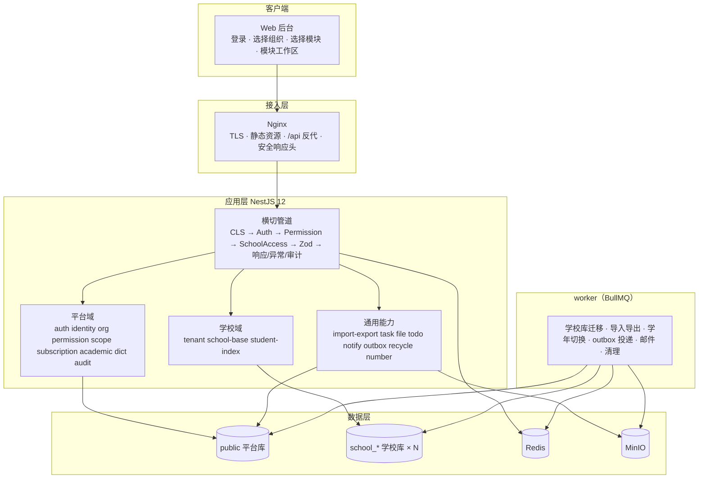
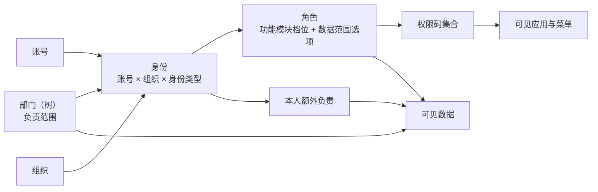
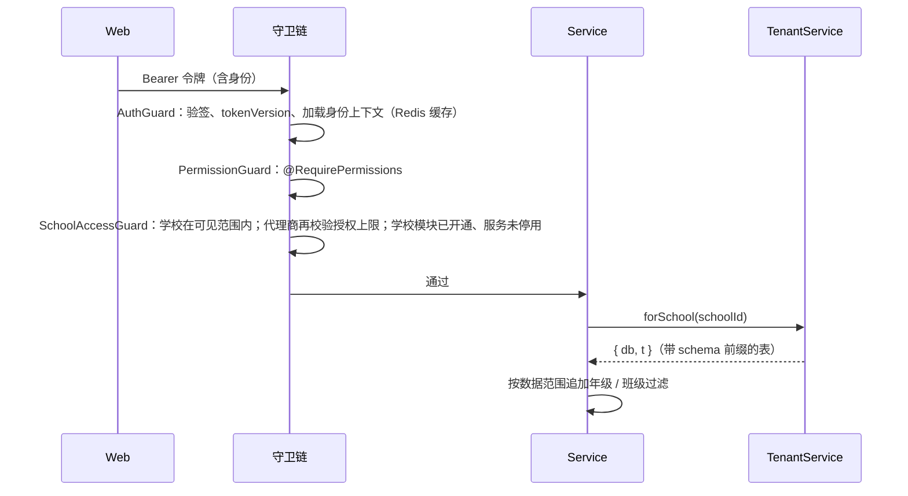
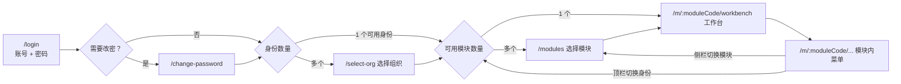

# 智慧体育云平台 · 架构说明

| 项         | 内容                                   |
| ---------- | -------------------------------------- |
| 版本       | v1.0（地基 M1）                        |
| 日期       | 2026-11-09                             |
| 对应架构图 | `docs/architecture-diagram.html` v0.19 |
| 详细规格   | `docs/spec/`（按功能拆分，共 16 份）   |
| 开发任务   | `docs/TASKS.md`                        |

本文回答两个问题：**系统整体怎么组织**，以及**关键决策为什么这样定**。字段、接口、规则等细节以 `docs/spec/` 为准；本文与规格冲突时，以规格为准并回头修正本文。

---

## 1. 背景与范围

平台服务五类主体：公司（研发、销售、生产、技术服务等部门）、省市区教育局、代理商、学校、教师，后续扩展学生和家长。一个人可以同时属于多个主体，用一个账号登录，选择组织后进入对应的模块页面。

**地基 M1 只交付 Web 后台管理**，内容是所有上层业务都依赖的基础能力：

- 账号、身份、组织、部门、角色、数据范围
- 学校数据隔离（一校一 schema）与学校服务开通
- 学年学期、学段年级、班级学生教师等基础数据
- 导入导出、任务中心、待办、字典、编号、审计等通用能力
- 后台外壳：登录 → 选择组织 → 选择模块 → 模块工作区（默认进入工作台）

**不在 M1**：移动端 H5（M2）、跳绳跑步等运动业务模块、赛事、中考、BI 大屏（M3 及以后）、第三方对接、完整恢复方案、中职学段、信创。

---

## 2. 术语

| 术语        | 含义                                                                                           |
| ----------- | ---------------------------------------------------------------------------------------------- |
| 账号        | 登录凭证，一人一个                                                                             |
| 组织 / 机构 | 公司、教育局、代理商、学校四类主体                                                             |
| 身份        | 账号 × 组织 × 身份类型。登录后“选择组织”选的就是身份                                           |
| 应用        | 权限码的命名空间，如 `org`、`school`；学校开通仍按应用记录，不直接作为前台入口卡片             |
| 模块        | 用户看到的入口。M1 包含“基础信息”“平台管理”，模块内按“分组 → 菜单”导航，详见 spec 04 第 3.1 节 |
| 功能模块    | 应用内配置权限的单位，如“学生管理”。每个功能模块有四档：无、查看、编辑、管理                   |
| 动作        | 按钮级权限：查、增、改、删、导入、导出，以及审核、查看敏感信息                                 |
| 外边界      | 某类组织最多能看到的数据：公司看全部学校，教育局看辖区，代理商看授权学校，学校看本校           |
| 数据范围    | 角色上的选项：本机构全部、本部门及以下、本部门、本人负责                                       |
| 学校库      | 每所学校独立的 PostgreSQL schema，命名 `school_<32 位十六进制>`                                |
| 平台库      | `public` schema，存账号、组织、权限、学年等全平台数据                                          |

---

## 3. 技术栈

| 层     | 选型                                                                                                                                           |
| ------ | ---------------------------------------------------------------------------------------------------------------------------------------------- |
| 运行时 | Node.js 当前 LTS（≥ 24），pnpm 10，Turborepo                                                                                                   |
| 后端   | NestJS 12（ESM），Zod 4（路由校验），Drizzle ORM，nestjs-cls，jose（JWT），argon2id，BullMQ，pino                                              |
| 前端   | React 19，Vite 7，HeroUI 3 + HeroUI Pro（布局、侧栏、KPI），Tailwind CSS 4，React Router 7，TanStack Query 5，zustand 5，react-hook-form + Zod |
| 数据   | PostgreSQL 17，Redis 8，MinIO（S3 接口）                                                                                                       |
| 质量   | Biome 2，Vitest，Playwright，Testcontainers                                                                                                    |
| 提交   | git cz（commitizen + cz-git），commitlint，husky                                                                                               |
| 部署   | Docker Compose，Nginx                                                                                                                          |
| 浏览器 | Chrome / Edge 111+、Firefox 128+、Safari 16.4+，不兼容旧浏览器                                                                                 |

---

## 4. 总体架构



---

## 5. 仓库结构

```
sports-cloud/
├─ apps/
│  ├─ server/            NestJS API
│  │  └─ src/
│  │     ├─ core/        guards · decorators · cls · filters · interceptors
│  │     ├─ infra/       database · tenant · redis · queue · storage · crypto
│  │     └─ modules/
│  │        ├─ platform/ auth identity org permission scope subscription academic dict audit
│  │        ├─ school/   school-base student-index
│  │        └─ foundation/ import-export task file todo notify outbox recycle number
│  ├─ worker/            BullMQ 消费者
│  └─ web/               React 19 + HeroUI 3
│     └─ src/
│        ├─ app/         providers · router
│        ├─ pages/       login · select-org · portal · 403 · 404 · upgrade-browser
│        ├─ layouts/     AppLayout（模块工作区）
│        ├─ apps/        按应用组织：system/ org-permission/ school-base/ school-ops/ org-admin/
│        └─ shared/      api · stores · hooks · <Can> · DataTable · SchemaForm · ScopePicker
├─ packages/
│  ├─ contracts/         Zod schema · 枚举 · 权限码 · 应用与功能模块声明 · 错误码
│  ├─ domain/            纯函数：年级计算 · 权限匹配 · 数据范围合并 · 评分换算
│  └─ config/            tsconfig · biome · vitest 预设
├─ deploy/               docker-compose.yml · nginx.conf · Dockerfile
└─ docs/                 ARCHITECTURE.md · spec/ · TASKS.md · architecture-diagram.html
```

---

## 6. 关键设计决策

每条决策记录“决定 / 理由 / 代价”。改变其中任何一条，需要先更新本节。

### ADR-01 学校数据一校一 schema

- **决定**：每所学校一个 `school_<hex>` schema；平台数据在 `public`；`school_tenants.datasource` 可把学校指向独立数据库实例。
- **理由**：数据归学校，需要能单独导出、迁移、销毁；隔离比 `school_id` 列加行级安全更强、更直观。
- **代价**：学校迁移要逐库执行；跨校统计不能直接查询，需汇总表。

### ADR-02 不切换 search_path

- **决定**：Drizzle 按 schema 名生成带前缀的表对象，SQL 一律写成 `"school_xxx"."students"`。
- **理由**：连接池里的连接被多个请求复用，切 search_path 容易串校。
- **代价**：表对象需要按 schema 缓存。

### ADR-03 JWT 只带最少信息

- **决定**：access token 只含 `userId`、`sessionId`、`identityId`、`tokenVersion`、`client`；权限和数据范围在服务端按身份计算并缓存。
- **理由**：改角色立即生效，无需重新登录；token 小；不会因 token 内过期权限越权。
- **代价**：每个请求要读缓存；缓存需要可靠失效。

### ADR-04 登录 → 选择组织 → 选择模块 → 模块工作区

- **决定**：账号密码登录先得到“账号级”令牌；选择组织后拿到带身份的令牌，再选择模块并进入该模块的工作台。唯一可用身份自动选择，唯一可用模块自动进入。账号级令牌允许的接口见 spec 01、02。
- **理由**：一人多身份是常态，进入系统前先明确“以谁的身份”；模块按身份和权限展示，权限码的应用命名空间保持稳定，后续运动业务可以增加模块入口。
- **代价**：多一步操作。只有一个身份时自动跳过选择。

### ADR-05 部门决定看哪些数据，角色决定能做什么

- **决定**：最终可见数据 = 组织外边界 ∩（角色数据范围 + 本人额外负责）。部门树挂“负责范围”，角色只选四个选项之一。
- **理由**：人员调动只改部门；部门新接学校只改部门；角色数量不随部门增加。
- **代价**：需要“实际可见”解释和预览，帮助管理员理解结果。

### ADR-06 权限按“功能模块 × 四档 × 动作”配置

- **决定**：角色存每个功能模块的档位；档位映射到动作，动作映射到权限码。内置角色的默认值随代码发布，公司超级管理员可以在“角色模板”里修改，修改单独存放、发布时不被覆盖；自定义角色只存差异。
- **理由**：管理员不用懂权限码；新功能上线自动进入所有角色。
- **代价**：功能模块的划分要在代码里认真维护。

### ADR-07 菜单与权限码以代码为准

- **决定**：应用、菜单、按钮、权限码、功能模块由 `packages/contracts` 声明，部署时同步到数据库；后台只能改显示名称、排序、图标、显隐。
- **理由**：避免数据库里的菜单与代码权限不一致。
- **代价**：加菜单要发版本。

### ADR-08 编码与 ID 不外露

- **决定**：主键统一 UUID v7；技术 ID 和系统编码不让用户输入、不显示；系统编号由编号规则生成；业务编号（学号、标识码等）可录入。
- **理由**：用户只面对能理解的名称和编号，避免误填与信息泄露。

### ADR-09 前后端共享 Zod 契约

- **决定**：请求、响应、导入模板都用 `packages/contracts` 中的 Zod schema 定义，后端路由校验、前端表单校验、类型推导、OpenAPI 生成共用一份。

### ADR-10 跨库写入用 outbox

- **决定**：同一数据源内的平台库与学校库写入放在一个事务；跨数据源时先写本地并记录 outbox 事件，worker 补齐另一侧。

### ADR-11 只支持新版浏览器

- **决定**：HeroUI 3 与 Tailwind 4 要求的浏览器版本为基线，版本不足显示升级提示，不做兼容。

### ADR-12 后台外壳与工作台采用 HeroUI Pro

- **决定**：后台整体布局用 HeroUI Pro 的 `AppLayout`（侧栏 + 顶栏 + 主区 + 右侧栏）与可折叠 `Sidebar`（支持图标栏模式）；每个模块工作台的统计卡片用 `KPI` / `KPIGroup`（趋势与迷你图）；视觉参考其 Analytics 仪表盘模板。业务组件仍以 HeroUI 3 开源组件为主。
- **理由**：成熟的企业后台外观与交互，减少自研布局与仪表盘组件的工作量，与 HeroUI 3 主题一致。
- **代价与前提**：
  - HeroUI Pro 为付费产品，需购买团队授权；安装需要私有包令牌，CI 与镜像构建通过密钥注入，不进代码库。
  - 开工前需书面确认授权条款覆盖“自有 SaaS 产品服务多所学校”以及“私有化部署交付给教育局”两种场景。
  - HeroUI Pro 的 v3 版本发布时间较短，需锁定版本；KPI、图表等组件按子路径导入。
  - 若授权不满足，退回方案：用 HeroUI 3 开源组件按同样布局自行实现，页面结构不变。

---

## 7. 身份、组织与权限



| 身份类型       | 组织   | 外边界     | 部门负责的单位   | 本人负责         |
| -------------- | ------ | ---------- | ---------------- | ---------------- |
| company        | 公司   | 全部学校   | 学校、区域       | 额外学校、区域   |
| bureau         | 教育局 | 辖区学校   | 区县、学校       | 额外区县、学校   |
| agent          | 代理商 | 授权学校   | 学校             | 额外学校         |
| school         | 学校   | 本校       | 学段、年级、学院 | 额外年级         |
| teacher        | 学校   | 本校       | 年级             | 任教班级（自动） |
| student        | 学校   | 本人       | —                | —                |
| parent（预留） | 学校   | 绑定的孩子 | —                | —                |

详见 `spec/02`、`spec/03`、`spec/04`、`spec/05`。

---

## 8. 数据架构

| Schema         | 内容                                                                                                                                                           |
| -------------- | -------------------------------------------------------------------------------------------------------------------------------------------------------------- |
| `public`       | 账号、身份、组织、部门、角色、菜单、区划、学年学期、学校租户登记、学校服务与模块、代理商授权、学生索引、字典、参数、编号、任务、文件、待办、消息、outbox、审计 |
| `school_<hex>` | 行政班、教学班、学院专业、学生、学年学籍、任课；以后的运动业务表                                                                                               |

约定：

- 主键 UUID v7；公共字段 `created_at, updated_at, created_by, updated_by, deleted_at, version`。
- 学校库引用平台数据只存 id，不建跨 schema 外键。
- 敏感字段加密存储并另存哈希；显示时脱敏。
- 时间一律 `timestamptz`，按 Asia/Shanghai 计算日期。

---

## 9. 请求链路



---

## 10. 前端架构

### 10.1 页面流



- **选择组织页**：按组织类型分组列出身份卡片（组织名、身份类型、部门），上次使用的排在最前；每次登录都显示（单身份自动跳过）。
- **选择模块页**：展示当前身份可用的模块卡片，不放工作台指标。M1 为“基础信息”和仅公司可见的“平台管理”；模块可见性、菜单与权限功能的映射见 spec 04 第 3.1 节。
- **模块工作区**：HeroUI Pro `AppLayout` + 可折叠 `Sidebar`（展开 / 图标栏两种模式），按“分组 → 菜单”展示；第一项固定为工作台，底部切换模块。顶栏有折叠按钮、面包屑、学年学期、待办、身份切换和用户菜单；主内容区包含页签栏。
- **工作台**：进入模块后默认打开，页签不能关闭；按身份和模块获取 `KPIGroup` 指标、待办、最近访问。没有可用模块时展示空状态。

### 10.2 状态

| 状态                   | 位置                                                  | 切换身份时                     |
| ---------------------- | ----------------------------------------------------- | ------------------------------ |
| access token、当前身份 | zustand（只在内存；刷新页面后用 refresh Cookie 恢复） | 替换                           |
| 当前学校               | zustand                                               | 多校身份清空；单校身份设为本校 |
| 当前模块、已打开页签   | zustand                                               | 清空，重新获取新身份可用模块   |
| 学年学期               | zustand                                               | 保留                           |
| 服务端数据             | TanStack Query（key 含身份与学校）                    | 全部清空                       |

详见 `spec/13`。

---

## 11. 部署

| 服务       | 说明                                                            |
| ---------- | --------------------------------------------------------------- |
| postgres   | PostgreSQL 17，数据卷持久化                                     |
| redis      | Redis 8                                                         |
| minio      | 文件存储                                                        |
| migrate    | 一次性任务：public 迁移 → 菜单与内置角色同步 → 各学校库增量迁移 |
| server × N | 无状态，滚动更新，优雅停机                                      |
| worker     | 后台任务                                                        |
| web        | Nginx：静态资源、`/api` 反代、安全响应头                        |

最低备份：每日全库 `pg_dump`，保留 7 天，存放在数据库服务器以外。

---

## 12. 非功能要求

| 项           | 目标                                     |
| ------------ | ---------------------------------------- |
| 学校规模     | 单库约 2000 所学校，超出后按区域拆数据源 |
| 鉴权开销     | 身份上下文命中缓存时 < 5ms               |
| 权限变更生效 | 改角色、部门、授权后 ≤ 5 秒生效          |
| 日志留存     | 操作日志、登录日志 ≥ 6 个月              |
| 合规         | 敏感字段加密与脱敏，满足等保常见要求     |

---

## 13. 开发方式与里程碑

**前后端同步推进**：M1 按 19 个功能切片推进（见 `TASKS.md`“前后端同步推进”）。每个切片先在 contracts 中写好接口契约，再后端实现与前端（基于 Mock）并行，最后联调、跑切片冒烟用例。每个后端原子任务合并后，立即检查对应前端任务能否开始或从 Mock 切换到真实接口。

| 里程碑    | 内容                                      |
| --------- | ----------------------------------------- |
| M1 地基   | 本文范围，Web 后台                        |
| M2 移动端 | 教师端、学生端 H5，学生账号登录           |
| M3 业务   | 跳绳、跑步等运动应用；赛事；中考体育      |
| M4 分析   | BI 大屏、跨校汇总、学校独立数据源迁移工具 |

---

## 14. 已确认的决策记录

| #   | 问题                                       | 决定                                                                                                                         | 落实位置                   |
| --- | ------------------------------------------ | ---------------------------------------------------------------------------------------------------------------------------- | -------------------------- |
| Q1  | 是否增加“审核”“查看敏感信息”动作           | 增加 `approve`、`sensitive`，归入管理档                                                                                      | spec 04、07、10、12        |
| Q2  | 公司员工查看、编辑学校明细是否需要学校授权 | 不需要，按公司数据范围直接访问，全部留审计                                                                                   | spec 05                    |
| Q3  | 教育局能否查看学校班级、学生明细           | 不能，只看学校列表；统计放到 BI（M4）                                                                                        | spec 04                    |
| Q4  | 多身份账号登录后是否每次选择组织           | 每次显示选择页，上次使用的置顶；单身份自动跳过                                                                               | spec 02、13                |
| Q5  | “谁能访问本校数据”透明页                   | 纳入 P1                                                                                                                      | spec 05、13，T-196         |
| Q6  | 架构图同步                                 | 已同步到架构图 v0.20                                                                                                         | 架构图                     |
| Q7  | 门户工作台与整体布局风格                   | 采用 HeroUI Pro（AppLayout、Sidebar、KPI）；需购买授权，见 ADR-12                                                            | spec 13、15                |
| Q8  | 用户看到的导航                             | 登录 → 选择组织 → 选择模块 → 模块工作区；M1 两个模块“基础信息”“平台管理”，各身份同一套分组名和菜单名；原“应用”只作权限码前缀 | spec 04 第 3.1 节、spec 13 |
| Q11 | 工作台的入口                               | 每个模块侧栏的第一项，进入模块后默认打开；登录即可用                                                                         | spec 13 第 2 节            |
| Q9  | 内置角色能否在界面修改                     | 公司超级管理员可以改默认数据范围和档位，对所有组织生效，可恢复默认；“超级管理员”角色本身不可改                               | spec 04 第 6.1 节          |
| Q10 | 流程的撤销与到期                           | 导入 24 小时内可撤销本批新增；学年升级 7 天内可撤回；代理商授权必须有到期日且最晚到学年结束                                  | spec 11、08、05            |

---

## 15. 规格索引

| 编号 | 文件                         | 内容                                                               |
| ---- | ---------------------------- | ------------------------------------------------------------------ |
| 00   | `spec/00-conventions.md`     | 接口、错误码、分页、编码与 ID、时间、幂等、版本                    |
| 01   | `spec/01-auth.md`            | 登录、令牌、锁定、邮箱验证码、密码策略、会话                       |
| 02   | `spec/02-identity.md`        | 身份、选择组织、切换身份、身份上下文                               |
| 03   | `spec/03-org.md`             | 组织、学校档案、区划、部门树、部门负责范围                         |
| 04   | `spec/04-permission.md`      | 应用、功能模块、档位、动作、角色、分级管理、菜单同步               |
| 05   | `spec/05-data-scope.md`      | 外边界、数据范围计算、代理商授权、缓存                             |
| 06   | `spec/06-tenant.md`          | 学校库开通、迁移、数据源、生命周期                                 |
| 07   | `spec/07-subscription.md`    | 学校服务状态、应用开通                                             |
| 08   | `spec/08-academic.md`        | 学年学期、学段年级编码、学年切换                                   |
| 09   | `spec/09-school-base.md`     | 行政班、教学班、院系、学生、教师任课                               |
| 10   | `spec/10-student-index.md`   | 身份证查重、升学、转学                                             |
| 11   | `spec/11-foundation.md`      | 导入导出、任务、文件、字典、参数、编号、消息、outbox、回收站、待办 |
| 12   | `spec/12-audit-security.md`  | 审计、敏感字段、密钥、安全基线、数据保留                           |
| 13   | `spec/13-admin-web.md`       | 后台页面流、外壳、通用组件、组织架构页、门户                       |
| 14   | `spec/14-init-onboarding.md` | 系统初始化、学校开通向导                                           |
| 15   | `spec/15-engineering.md`     | 仓库、CI、环境、提交规范、部署、备份、发布                         |
| 16   | `spec/16-code-standards.md`  | 后端三层模块结构、前端四层组件、依赖方向与自动检查                 |
